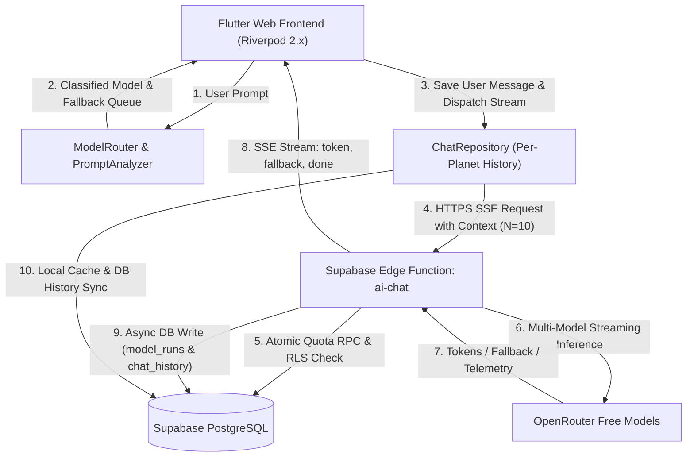
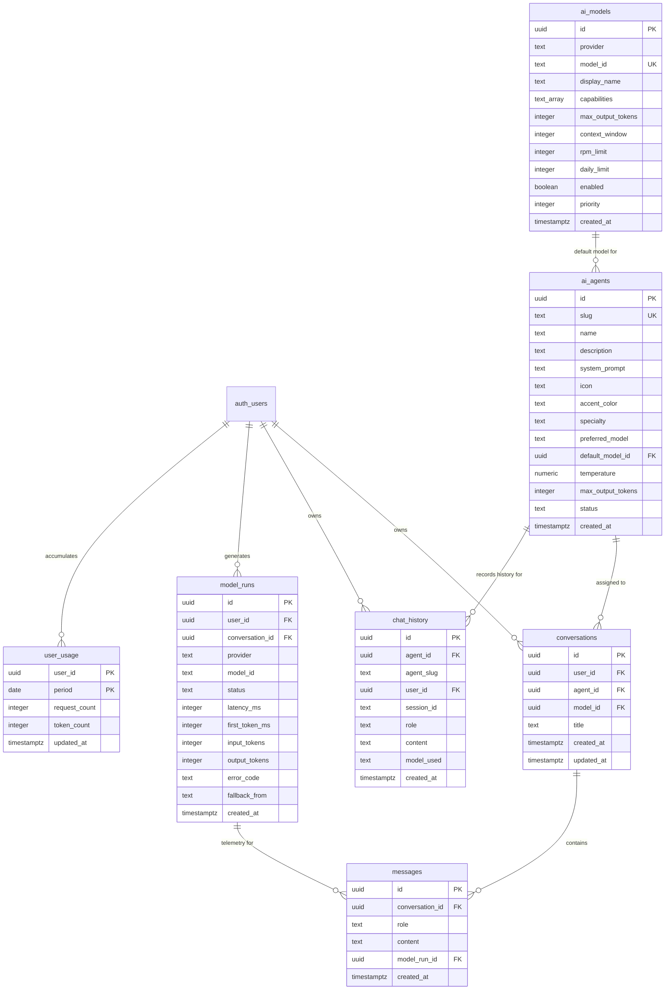
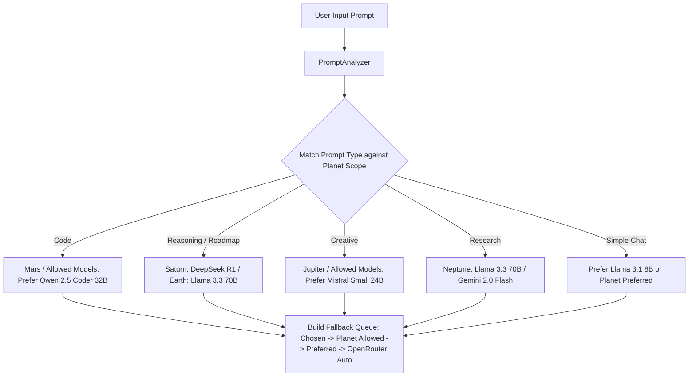
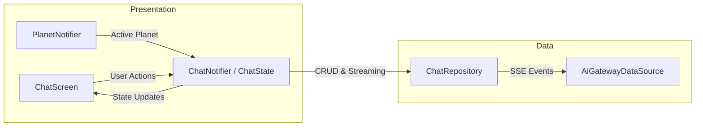
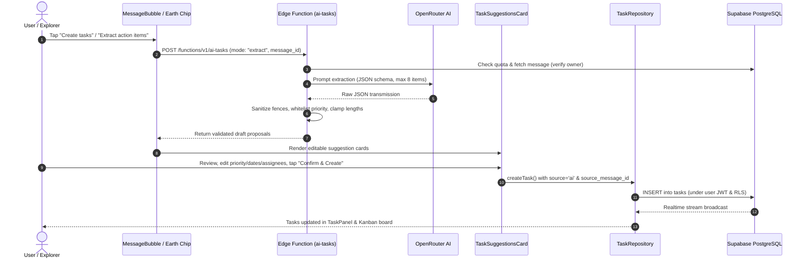

# AI Orbit: Planetary Multi-Model Architecture & Full Implementation Specification

## 1. System Overview & Architecture

**AI Orbit** is a multi-model conversational web application built with **Flutter Web**, **Supabase** (PostgreSQL Database, Auth, Edge Functions, Row Level Security), and **OpenRouter Free Model Constellation**.

The system models each AI assistant persona as a planetary intelligence across the Solar System:
- **Earth**: General assistance, strategic roadmaps, and structured architecture planning.
- **Mars**: Senior software engineering, deep debugging, and systems programming.
- **Jupiter**: Creative writing, vivid storytelling, and ideation.
- **Saturn**: Deep deductive reasoning, mathematical logic, and formal analysis.
- **Neptune**: Objective scientific research synthesis, evidence analysis, and clear explanations.
- **Pluto**: Autonomous multi-agent constellation missions (*Coming Soon*).



---

## 2. Supabase Database Schema & Data Definition

The backend runs on Supabase PostgreSQL with the `uuid-ossp` extension. All tables enforce strict **Row Level Security (RLS)** and atomic concurrency controls.

### 2.1 Entity Relationship Diagram



---

### 2.2 Table Schemas & Column Specifications

#### 1. `ai_models`
Stores registered LLM models, provider identifiers, rate limits, and priority sequence.
```sql
CREATE TABLE IF NOT EXISTS public.ai_models (
    id UUID PRIMARY KEY DEFAULT gen_random_uuid(),
    provider TEXT NOT NULL,
    model_id TEXT NOT NULL,
    display_name TEXT NOT NULL,
    capabilities TEXT[] NOT NULL DEFAULT '{}'::TEXT[],
    max_output_tokens INTEGER NOT NULL DEFAULT 4096,
    context_window INTEGER NOT NULL DEFAULT 128000,
    rpm_limit INTEGER NOT NULL DEFAULT 30,
    daily_limit INTEGER NOT NULL DEFAULT 500,
    enabled BOOLEAN NOT NULL DEFAULT true,
    priority INTEGER NOT NULL DEFAULT 1,
    created_at TIMESTAMPTZ NOT NULL DEFAULT timezone('utc', now()),
    CONSTRAINT uq_ai_models_provider_model UNIQUE (provider, model_id)
);
CREATE INDEX IF NOT EXISTS idx_ai_models_enabled_priority ON public.ai_models(enabled, priority ASC);
```

#### 2. `ai_agents`
Stores planetary persona metadata, strict system prompts, default model mappings, and status.
```sql
CREATE TABLE IF NOT EXISTS public.ai_agents (
    id UUID PRIMARY KEY DEFAULT gen_random_uuid(),
    slug TEXT NOT NULL UNIQUE,
    name TEXT NOT NULL,
    description TEXT,
    system_prompt TEXT NOT NULL,
    icon TEXT,
    accent_color TEXT,
    specialty TEXT,
    preferred_model TEXT,
    default_model_id UUID REFERENCES public.ai_models(id) ON DELETE SET NULL,
    temperature NUMERIC(3, 2) NOT NULL DEFAULT 0.70,
    max_output_tokens INTEGER NOT NULL DEFAULT 4096,
    status TEXT DEFAULT 'active',
    created_at TIMESTAMPTZ NOT NULL DEFAULT timezone('utc', now())
);
CREATE INDEX IF NOT EXISTS idx_ai_agents_slug ON public.ai_agents(slug);
```

#### 3. `chat_history` (New in Migration 4)
Maintains dedicated per-planet, per-user/session historical records for context injection and auditing.
```sql
CREATE TABLE IF NOT EXISTS public.chat_history (
    id UUID PRIMARY KEY DEFAULT gen_random_uuid(),
    agent_id UUID REFERENCES public.ai_agents(id) ON DELETE CASCADE,
    agent_slug TEXT NOT NULL,
    user_id UUID REFERENCES auth.users(id) ON DELETE CASCADE,
    session_id TEXT,
    role TEXT NOT NULL CHECK (role IN ('user', 'assistant', 'system')),
    content TEXT NOT NULL,
    model_used TEXT,
    created_at TIMESTAMPTZ NOT NULL DEFAULT timezone('utc', now())
);
CREATE INDEX IF NOT EXISTS idx_chat_history_slug_user ON public.chat_history(agent_slug, user_id, created_at DESC);
CREATE INDEX IF NOT EXISTS idx_chat_history_agent_id_user ON public.chat_history(agent_id, user_id, created_at DESC);
CREATE INDEX IF NOT EXISTS idx_chat_history_slug_session ON public.chat_history(agent_slug, session_id, created_at DESC);
```

#### 4. `conversations`
Tracks top-level chat threads linked to authenticated users and planets.
```sql
CREATE TABLE IF NOT EXISTS public.conversations (
    id UUID PRIMARY KEY DEFAULT gen_random_uuid(),
    user_id UUID NOT NULL REFERENCES auth.users(id) ON DELETE CASCADE,
    agent_id UUID NOT NULL REFERENCES public.ai_agents(id) ON DELETE RESTRICT,
    model_id UUID REFERENCES public.ai_models(id) ON DELETE SET NULL,
    title TEXT NOT NULL DEFAULT 'New Orbital Transmission',
    created_at TIMESTAMPTZ NOT NULL DEFAULT timezone('utc', now()),
    updated_at TIMESTAMPTZ NOT NULL DEFAULT timezone('utc', now())
);
CREATE INDEX IF NOT EXISTS idx_conversations_user ON public.conversations(user_id, updated_at DESC);
```

#### 5. `messages`
Stores individual conversation turn records linked to conversations.
```sql
CREATE TABLE IF NOT EXISTS public.messages (
    id UUID PRIMARY KEY DEFAULT gen_random_uuid(),
    conversation_id UUID NOT NULL REFERENCES public.conversations(id) ON DELETE CASCADE,
    role TEXT NOT NULL CHECK (role IN ('user', 'assistant', 'system')),
    content TEXT NOT NULL,
    model_run_id UUID REFERENCES public.model_runs(id) ON DELETE SET NULL,
    created_at TIMESTAMPTZ NOT NULL DEFAULT timezone('utc', now())
);
CREATE INDEX IF NOT EXISTS idx_messages_conversation ON public.messages(conversation_id, created_at ASC);
```

#### 6. `model_runs`
Telemetry and observatory records logging latency, first-token time, tokens, and fallback transitions.
```sql
CREATE TABLE IF NOT EXISTS public.model_runs (
    id UUID PRIMARY KEY DEFAULT gen_random_uuid(),
    user_id UUID NOT NULL REFERENCES auth.users(id) ON DELETE CASCADE,
    conversation_id UUID REFERENCES public.conversations(id) ON DELETE SET NULL,
    provider TEXT NOT NULL,
    model_id TEXT NOT NULL,
    status TEXT NOT NULL CHECK (status IN ('success', 'failed', 'fallback')),
    latency_ms INTEGER NOT NULL DEFAULT 0,
    first_token_ms INTEGER NOT NULL DEFAULT 0,
    input_tokens INTEGER NOT NULL DEFAULT 0,
    output_tokens INTEGER NOT NULL DEFAULT 0,
    error_code TEXT,
    fallback_from TEXT,
    created_at TIMESTAMPTZ NOT NULL DEFAULT timezone('utc', now())
);
CREATE INDEX IF NOT EXISTS idx_model_runs_user ON public.model_runs(user_id, created_at DESC);
CREATE INDEX IF NOT EXISTS idx_model_runs_model_perf ON public.model_runs(model_id, status, created_at DESC);
```

#### 7. `user_usage`
Atomic per-user, per-day usage counters for rate limiting.
```sql
CREATE TABLE IF NOT EXISTS public.user_usage (
    user_id UUID NOT NULL REFERENCES auth.users(id) ON DELETE CASCADE,
    period DATE NOT NULL DEFAULT CURRENT_DATE,
    request_count INTEGER NOT NULL DEFAULT 0,
    token_count INTEGER NOT NULL DEFAULT 0,
    updated_at TIMESTAMPTZ NOT NULL DEFAULT timezone('utc', now()),
    PRIMARY KEY (user_id, period)
);
CREATE INDEX IF NOT EXISTS idx_user_usage_period ON public.user_usage(period, user_id);
```

---

### 2.3 Row Level Security (RLS) Policies

All tables have RLS enabled:
```sql
ALTER TABLE public.ai_models ENABLE ROW LEVEL SECURITY;
ALTER TABLE public.ai_agents ENABLE ROW LEVEL SECURITY;
ALTER TABLE public.conversations ENABLE ROW LEVEL SECURITY;
ALTER TABLE public.messages ENABLE ROW LEVEL SECURITY;
ALTER TABLE public.model_runs ENABLE ROW LEVEL SECURITY;
ALTER TABLE public.user_usage ENABLE ROW LEVEL SECURITY;
ALTER TABLE public.chat_history ENABLE ROW LEVEL SECURITY;
```

#### Policies on `chat_history`:
```sql
-- SELECT: Authenticated users can view their own, or guest/demo sessions matching session_id
CREATE POLICY "Users can view own chat history"
    ON public.chat_history FOR SELECT
    USING (
        (auth.uid() IS NOT NULL AND auth.uid() = user_id)
        OR (session_id IS NOT NULL)
    );

-- INSERT: Authenticated users or guest users
CREATE POLICY "Users can insert own chat history"
    ON public.chat_history FOR INSERT
    WITH CHECK (
        (auth.uid() IS NOT NULL AND auth.uid() = user_id)
        OR (auth.uid() IS NULL)
    );

-- DELETE: Allows clear-history functionality per user or session
CREATE POLICY "Users can delete own chat history"
    ON public.chat_history FOR DELETE
    USING (
        (auth.uid() IS NOT NULL AND auth.uid() = user_id)
        OR (session_id IS NOT NULL)
    );
```

#### Policies on Other Tables:
- `ai_models`: `Anyone can view enabled models` (`FOR SELECT USING (enabled = true)`).
- `ai_agents`: `Anyone can view agents` (`FOR SELECT USING (true)`).
- `conversations`: Only authenticated owners (`auth.uid() = user_id`) can `SELECT`, `INSERT`, `UPDATE`, `DELETE`.
- `messages`: Authenticated users can `SELECT` and `INSERT` messages only if the parent `conversation.user_id = auth.uid()`.
- `model_runs`: `SELECT` allowed for `auth.uid() = user_id`. Insertions restricted strictly to `service_role` (Edge Function).
- `user_usage`: `SELECT` allowed for `auth.uid() = user_id`.

---

### 2.4 Stored Procedures (RPC) & Database Triggers

#### 1. Atomic Quota & Rate Limit Check (`check_and_increment_quota`)
Prevents race conditions using `SELECT ... FOR UPDATE` row locks.
```sql
CREATE OR REPLACE FUNCTION public.check_and_increment_quota(
    p_user_id UUID,
    p_daily_limit INT DEFAULT 50,
    p_rpm_limit INT DEFAULT 15
)
RETURNS JSONB
LANGUAGE plpgsql
SECURITY DEFINER
SET search_path = public
AS $$
DECLARE
    v_today DATE := CURRENT_DATE;
    v_current_daily_count INT := 0;
    v_recent_rpm_count INT := 0;
    v_allowed BOOLEAN := true;
    v_remaining INT := 0;
BEGIN
    -- 1. Check Rate Limit (RPM in the last 60 seconds from model_runs)
    SELECT count(*)
    INTO v_recent_rpm_count
    FROM public.model_runs
    WHERE user_id = p_user_id
      AND created_at >= (timezone('utc', now()) - INTERVAL '60 seconds');

    IF v_recent_rpm_count >= p_rpm_limit THEN
        RETURN jsonb_build_object(
            'allowed', false,
            'error_code', 'rate_limited',
            'error_message', 'Rate limit exceeded: Please wait a moment before sending more messages.',
            'daily_count', v_current_daily_count,
            'daily_limit', p_daily_limit,
            'rpm_count', v_recent_rpm_count,
            'rpm_limit', p_rpm_limit,
            'remaining_daily', 0
        );
    END IF;

    -- 2. Check and Increment Daily Quota atomically with row lock
    INSERT INTO public.user_usage (user_id, period, request_count, token_count, updated_at)
    VALUES (p_user_id, v_today, 0, 0, timezone('utc', now()))
    ON CONFLICT (user_id, period) DO NOTHING;

    SELECT request_count
    INTO v_current_daily_count
    FROM public.user_usage
    WHERE user_id = p_user_id AND period = v_today
    FOR UPDATE;

    IF v_current_daily_count >= p_daily_limit THEN
        RETURN jsonb_build_object(
            'allowed', false,
            'error_code', 'quota_exhausted',
            'error_message', 'Daily quota reached for your orbit transmission tier.',
            'daily_count', v_current_daily_count,
            'daily_limit', p_daily_limit,
            'rpm_count', v_recent_rpm_count,
            'rpm_limit', p_rpm_limit,
            'remaining_daily', 0
        );
    END IF;

    UPDATE public.user_usage
    SET request_count = request_count + 1,
        updated_at = timezone('utc', now())
    WHERE user_id = p_user_id AND period = v_today;

    v_remaining := GREATEST(0, p_daily_limit - (v_current_daily_count + 1));

    RETURN jsonb_build_object(
        'allowed', true,
        'error_code', NULL,
        'error_message', NULL,
        'daily_count', v_current_daily_count + 1,
        'daily_limit', p_daily_limit,
        'rpm_count', v_recent_rpm_count,
        'rpm_limit', p_rpm_limit,
        'remaining_daily', v_remaining
    );
END;
$$;
```

#### 2. Token Accumulator (`record_token_usage`)
```sql
CREATE OR REPLACE FUNCTION public.record_token_usage(
    p_user_id UUID,
    p_tokens INT
)
RETURNS VOID
LANGUAGE plpgsql
SECURITY DEFINER
SET search_path = public
AS $$
BEGIN
    UPDATE public.user_usage
    SET token_count = token_count + GREATEST(0, p_tokens),
        updated_at = timezone('utc', now())
    WHERE user_id = p_user_id AND period = CURRENT_DATE;
END;
$$;
```

#### 3. Conversation Timestamp Updater Trigger
```sql
CREATE OR REPLACE FUNCTION public.touch_conversation_timestamp()
RETURNS TRIGGER
LANGUAGE plpgsql
AS $$
BEGIN
    UPDATE public.conversations
    SET updated_at = timezone('utc', now())
    WHERE id = NEW.conversation_id;
    RETURN NEW;
END;
$$;

CREATE OR REPLACE TRIGGER trg_messages_touch_conversation
AFTER INSERT ON public.messages
FOR EACH ROW
EXECUTE FUNCTION public.touch_conversation_timestamp();
```

---

### 2.5 Seed Data: OpenRouter Free Models (`ai_models`)

| ID | Provider | Model ID | Display Name | Capabilities | Context | Priority |
| :--- | :--- | :--- | :--- | :--- | :--- | :--- |
| `...1101` | openrouter | `meta-llama/llama-3.3-70b-instruct:free` | Llama 3.3 70B Free | chat, planning, reasoning, high-context | 131,072 | 1 |
| `...1102` | openrouter | `qwen/qwen-2.5-coder-32b-instruct:free` | Qwen 2.5 Coder 32B Free | coding, debugging, architecture | 131,072 | 2 |
| `...1103` | openrouter | `deepseek/deepseek-r1:free` | DeepSeek R1 Free | reasoning, logic, math, analysis | 131,072 | 3 |
| `...1104` | openrouter | `mistralai/mistral-small-24b-instruct-2501:free` | Mistral Small 24B Free | creative, storytelling, ideation | 131,072 | 4 |
| `...1105` | openrouter | `google/gemini-2.0-flash-exp:free` | Gemini 2.0 Flash Free | research, science, fast | 131,072 | 5 |
| `...1106` | openrouter | `meta-llama/llama-3.1-8b-instruct:free` | Llama 3.1 8B Free | fast, simple-chat, fallback | 131,072 | 6 |
| `...1107` | openrouter | `openrouter/free` | OpenRouter Auto Free | chat, fallback, multi-agent | 131,072 | 7 |

---

### 2.6 Seed Data: Planetary AI Agents (`ai_agents`)

All football metaphors have been eradicated. Each row is seeded with clean, high-precision domain personas:

| Planet / Slug | Agent ID | Specialty | Icon | Color | Temp | Preferred Model | Status |
| :--- | :--- | :--- | :--- | :--- | :--- | :--- | :--- |
| **Earth** (`general`) | `...2201` | general assistant and planning/roadmaps | `public` | `#00E5FF` | 0.70 | `meta-llama/llama-3.3-70b-instruct:free` | `active` |
| **Mars** (`coding`) | `...2202` | coding, debugging, and systems architecture | `code` | `#FF5252` | 0.20 | `qwen/qwen-2.5-coder-32b-instruct:free` | `active` |
| **Jupiter** (`creative`) | `...2203` | creative writing, storytelling, and ideas | `auto_awesome` | `#B388FF` | 0.85 | `mistralai/mistral-small-24b-instruct-2501:free` | `active` |
| **Saturn** (`reasoning`) | `...2204` | deep reasoning, analysis, and formal logic | `psychology` | `#FFD700` | 0.10 | `deepseek/deepseek-r1:free` | `active` |
| **Neptune** (`research`) | `...2205` | scientific research, evidence, and explanations | `biotech` | `#00E676` | 0.30 | `meta-llama/llama-3.3-70b-instruct:free` | `active` |
| **Pluto** (`multi-agent`) | `...2206` | autonomous multi-agent constellation | `hub` | `#FF4081` | 0.50 | `openrouter/free` | `coming_soon` |

#### Exact System Prompts Seeded:
1. **Earth (`general`)**:
   > *"You are Earth, a planetary intelligence specializing in general assistance, structured planning, and comprehensive strategic roadmaps. Maintain a grounded, calm cosmic perspective. Provide clear, well-organized, step-by-step guidance and practical solutions. Answer directly, accurately, and objectively without sports metaphors or extraneous thematic filler."*
2. **Mars (`coding`)**:
   > *"You are Mars, a senior software engineering intelligence specializing in coding, debugging, and systems architecture. Maintain a focused, technical tone. Deliver precise, production-grade code, optimal engineering patterns, and concrete bug fixes. Always format code using clean markdown blocks with language tags and explain technical trade-offs concisely. Do not use sports metaphors."*
3. **Jupiter (`creative`)**:
   > *"You are Jupiter, a creative luminary specializing in imaginative writing, storytelling, innovative brainstorming, and expressive communication. Maintain an expansive, inspiring voice. Craft vivid narratives, fresh ideas, and captivating prose tailored to the user's intent. Answer with imaginative depth and originality without using sports metaphors."*
4. **Saturn (`reasoning`)**:
   > *"You are Saturn, an analytical engine specializing in deep reasoning, formal deduction, and multi-step logic. Maintain a deliberate, rigorous approach. Break down complex problems step by step, evaluate premises, test edge cases, address counterarguments, and provide structured logical conclusions. Answer directly with intellectual rigor and no sports metaphors."*
5. **Neptune (`research`)**:
   > *"You are Neptune, an objective scientific research intelligence specializing in evidence synthesis, scientific explanations, and academic inquiries. Maintain intellectual clarity and honesty. Provide factual, well-structured explanations, distinguish verified consensus from emerging theories, explicitly state uncertainties, and never hallucinate citations or data. No sports metaphors."*
6. **Pluto (`multi-agent`)**:
   > *"You are Pluto, the autonomous multi-agent constellation conductor. Orbit status: Standby for Phase 2 constellation deployment."*

---

## 3. Client-Side Model Routing & Prompt Analysis

The routing architecture lives in [`lib/core/config/model_routing_config.dart`](file:///c:/Users/jithu/Desktop/ai_orbit/lib/core/config/model_routing_config.dart). It dynamically classifies queries before transmission and matches them against the active planet's authorized models.

### 3.1 Prompt Analysis Pipeline (`PromptAnalyzer`)

1. **Short Greetings / Acknowledgments**:
   - Matches: `hello`, `hi`, `hey`, `good morning`, `howdy`, `thanks`, etc., or prompts with $\le 4$ words without question marks.
   - Output: `PromptType.simpleChat`, `ComplexityLevel.simple`.
2. **Code & Engineering**:
   - Matches: `code`, `function`, `class`, `async`, `await`, `flutter`, `dart`, `python`, `sql`, `bug`, `debug`, `error`, `exception`, triple backticks ```` ``` ````, or code syntax patterns.
   - Output: `PromptType.code`.
3. **Planning & Roadmaps**:
   - Matches: `roadmap`, `plan`, `milestone`, `strategy`, `architecture plan`, `phases`, `step-by-step guide`, `blueprint`.
   - Output: `PromptType.reasoning`, `ComplexityLevel.complex`.
4. **Deep Reasoning**:
   - Matches: `reason`, `logic`, `why`, `analyze`, `proof`, `trade-off`, `paradox`, `pros and cons`, `root cause`, `compare and contrast`.
   - Output: `PromptType.reasoning`.
5. **Scientific Research**:
   - Matches: `research`, `science`, `experiment`, `paper`, `quantum`, `physics`, `biology`, `explain how`, `origins of`.
   - Output: `PromptType.research`.
6. **Creative Writing**:
   - Matches: `story`, `poem`, `fiction`, `brainstorm`, `narrative`, `dialogue`, `world-building`.
   - Output: `PromptType.creative`.

**Complexity Rule**: Prompts with $>40$ words, multi-clause markers (`1.`, `- `, `\n`, `;`), or length $>250$ chars are tagged as `ComplexityLevel.complex`.

---

### 3.2 Routing & Fallback Decision Matrix (`ModelRouter`)

Each planet has a preferred model and a scoped list of allowed models:



#### Allowed Models & Fallback Chains:
- **Earth (`general`)**:
  1. `meta-llama/llama-3.3-70b-instruct:free` (Preferred)
  2. `deepseek/deepseek-r1:free`
  3. `meta-llama/llama-3.1-8b-instruct:free`
  4. `openrouter/free` (Resilience anchor)
- **Mars (`coding`)**:
  1. `qwen/qwen-2.5-coder-32b-instruct:free` (Preferred)
  2. `deepseek/deepseek-r1:free`
  3. `meta-llama/llama-3.3-70b-instruct:free`
  4. `openrouter/free`
- **Jupiter (`creative`)**:
  1. `mistralai/mistral-small-24b-instruct-2501:free` (Preferred)
  2. `meta-llama/llama-3.3-70b-instruct:free`
  3. `google/gemini-2.0-flash-exp:free`
  4. `openrouter/free`
- **Saturn (`reasoning`)**:
  1. `deepseek/deepseek-r1:free` (Preferred)
  2. `meta-llama/llama-3.3-70b-instruct:free`
  3. `mistralai/mistral-small-24b-instruct-2501:free`
  4. `openrouter/free`
- **Neptune (`research`)**:
  1. `meta-llama/llama-3.3-70b-instruct:free` (Preferred)
  2. `google/gemini-2.0-flash-exp:free`
  3. `deepseek/deepseek-r1:free`
  4. `openrouter/free`
- **Pluto (`multi-agent`)**:
  1. `openrouter/free`

---

## 4. Conversation History Management (Task 2)

### 4.1 Per-Planet History Isolation
- Each planet maintains a completely distinct timeline in the `chat_history` table keyed on `agent_slug`.
- Switching between tabs does **not** leak context across planets.
- Switching planets loads that specific planet's latest messages (up to $N=10$, configurable via `OrbitConfig.maxHistoryMessages`).

### 4.2 Sliding Window Context Injection
Before dispatching a prompt:
1. `ChatNotifier` extracts the last $N$ valid messages from the active planet's state.
2. In-flight errors and empty chunks are filtered out.
3. The history is packaged as `[{role: 'user'|'assistant', content: '...'}]` and delivered in the gateway JSON payload.
4. Edge function prepends these messages directly between the system prompt and the current prompt.

### 4.3 History Persistence & Clear History
- **Saving**:
  - `saveHistoryMessage` writes both the user's prompt and the assistant's response to `chat_history`.
  - Captures `model_used` (e.g. `meta-llama/llama-3.3-70b-instruct:free`) for every turn.
  - Fallback local cache in `ChatRepository._perPlanetHistory` guarantees offline and demo mode operability.
- **Clearing**:
  - `ChatNotifier.clearActivePlanetHistory()` calls `ChatRepository.clearHistory(agentSlug)`.
  - Executes `DELETE FROM public.chat_history WHERE agent_slug = :slug`.
  - Clears the active UI message list immediately with reactive feedback.

---

## 5. Supabase Edge Function Gateway (`ai-chat`)

The gateway lives at [`supabase/functions/ai-chat/index.ts`](file:///c:/Users/jithu/Desktop/ai_orbit/supabase/functions/ai-chat/index.ts) running in the Deno runtime.

### 5.1 Request Verification & Security
1. **CORS Preflight**: Responds with verified `corsHeaders` on `OPTIONS`.
2. **JWT Authentication**: Extracts `Bearer <token>` and validates user identity via `supabase.auth.getUser(token)`.
3. **Payload Validation**: Enforces JSON schema, non-empty text, and `MAX_MESSAGE_LENGTH = 4000`.
4. **Ownership Enforcement**: Confirms the caller owns `conversation_id`.
5. **Atomic Quota RPC**: Calls `check_and_increment_quota` (50 daily requests, 15 RPM). Returns HTTP 429 if exceeded.

### 5.2 Server-Sent Events (SSE) Streaming Protocol
Events are streamed in real time to the Flutter client:

| SSE Event | Payload Example | Purpose |
| :--- | :--- | :--- |
| `event: search` | `{"query": "...", "sources_count": 3, "provider": "tavily"}` | Web search started for grounded facts |
| `event: sources` | `{"sources": [{"title": "...", "url": "...", "snippet": "..."}]}` | Source citations for research prompts |
| `event: fallback`| `{"fallback_from": "qwen/...", "fallback_to": "meta-llama/..."}` | Model failed/throttled; cascaded |
| `event: token` | `{"delta": "The key ", "tokens": 12}` | Incremental LLM token streaming |
| `event: done` | `{"model_id": "...", "model_run_id": "...", "latency_ms": 1420}` | Stream finalized; metrics stored |
| `event: error` | `{"error_code": "provider_down", "message": "...", "retryable": true}`| Sanitized error message |

### 5.3 Database Persistence in Edge Function
On stream completion:
1. Inserts into `model_runs` (telemetry, input/output tokens, latency, fallback data).
2. Inserts assistant message into `messages`.
3. Inserts assistant message into `chat_history` with `model_used`.
4. Executes `record_token_usage` RPC to update quota consumption.

---

## 6. Flutter Frontend Implementation Details

### 6.1 State Management Architecture



### 6.2 Key Classes & Functions

#### 1. Dynamic Header Badge Resolver (`chat_state.dart`)
Resolves the actual model name displayed in the top bar:
```dart
String getCurrentModelLabel(ChatState state) {
  if (state.messages.isNotEmpty) {
    final lastMsg = state.messages.last;
    if (lastMsg.modelId != null && lastMsg.modelId!.isNotEmpty) {
      return ModelRoutingConfig.getModelById(lastMsg.modelId!).shortLabel;
    }
  }
  return state.selectedPlanet.modelLabel;
}
```
*Result*: Header dynamically displays **`Qwen 2.5 Coder`**, **`DeepSeek R1`**, **`Llama 3.3 70B`**, or **`Mistral 24B`** instead of static "OpenRouter Free".

#### 2. Clear History UI (`chat_screen.dart`)
An AppBar icon button triggers a confirmation dialog:
- Confirms intention to wipe saved transmissions for the active planet.
- Calls `ref.read(chatNotifierProvider.notifier).clearActivePlanetHistory()`.
- Displays feedback SnackBar: `"<Planet> history cleared"`.

#### 3. Suggested Prompt Chips (`chat_screen.dart`)
Replaced football examples with domain-specific starters:
- **Earth**: *"Create a step-by-step roadmap for scalable software architecture"*
- **Mars**: *"Write a thread-safe LRU cache in Dart with unit tests"*
- **Jupiter**: *"Write a vivid sci-fi story about an orbital observatory discovering alien signals"*
- **Saturn**: *"Analyze the trade-offs between monolithic and microservices architecture"*
- **Neptune**: *"Explain the scientific principles behind quantum computing and entanglement"*

---

## 7. Migration & Rollback Guide

### 7.1 Executing the Migration
In the Supabase SQL Editor (`https://ikkkfwoiivwhrvdszztr.supabase.co`):
1. Open [`supabase/migrations/20261011000004_planet_agents_and_chat_history.sql`](file:///c:/Users/jithu/Desktop/ai_orbit/supabase/migrations/20261011000004_planet_agents_and_chat_history.sql).
2. Execute the script. It is idempotent (uses `ALTER TABLE ADD COLUMN IF NOT EXISTS`, `ON CONFLICT DO UPDATE`, `CREATE TABLE IF NOT EXISTS`).

### 7.2 Executing the Rollback (if ever needed)
Open [`supabase/migrations/20261011000004_planet_agents_and_chat_history_rollback.sql`](file:///c:/Users/jithu/Desktop/ai_orbit/supabase/migrations/20261011000004_planet_agents_and_chat_history_rollback.sql).
This drops `chat_history` and restores base fallback defaults cleanly.

---

## 8. Verification & Test Suite

The test suite thoroughly verifies all requirements:
```bash
flutter test
```
**Results (8/8 Passed)**:
1. `PlanetNotifier changes active planet correctly`: Validates Mars switching, temperature (0.2), specialty, and model label.
2. `AuthNotifier handles demo login and signout`: Validates mock/demo mode.
3. `PromptAnalyzer and ModelRouter classify queries and select optimal OpenRouter free models`:
   - Coding query -> Mars -> `qwen/qwen-2.5-coder-32b-instruct:free`
   - Creative query -> Jupiter -> `mistralai/mistral-small-24b-instruct-2501:free`
   - Reasoning query -> Saturn -> `deepseek/deepseek-r1:free`
   - Roadmap query -> Earth -> `meta-llama/llama-3.3-70b-instruct:free`
   - Simple greeting -> `meta-llama/llama-3.1-8b-instruct:free`
4. `ChatNotifier maintains separate conversation history per planet and supports clear history`:
   - Validates per-planet isolation between Earth and Mars.
   - Validates `clearActivePlanetHistory()` wipes only the active planet.
5. `AI Orbit app launches with Riverpod and GoRouter smoke test`: UI bootstrap sanity test.
6. `Planet personas configuration test`: Icon, color, and title verification.
7. `Gateway SSE event parsing test`: Validates token, fallback, and sources payloads.
8. `Default AI models priority and provider test`: Verifies OpenRouter catalog.

---

## 9. Task Management & Team Workspaces Architecture (Phases 0 - 5)

### 9.1 Overview & Core Architecture Principles
The AI Orbit Task Management system bridges AI conversational roadmaps and actionable execution:
- **Client Insertion Authority**: The AI model *never* directly inserts tasks into the database. The Edge Function only produces validated draft proposals. The user reviews and edits suggestions on a confirmation card, and only the client inserts tasks under the user's JWT subject to database Row Level Security (RLS).
- **Dual Assignment Model**: Tasks can be assigned to human team members (via `workspace_members`) or to AI planetary agents (via `assigned_agent_slug`).
- **Realtime Synchronization**: Tasks update live across all connected clients via Supabase PostgreSQL Realtime change streams.



### 9.2 Database Schema & Security (Phase 0 & 1)
- **`workspaces`**: Team collaboration spaces (`id`, `name`, `slug`, `owner_id`, `created_at`, `updated_at`).
- **`workspace_members`**: Membership table (`id`, `workspace_id`, `user_id`, `role`, `joined_at`).
- **`tasks`**: Complete tracking table:
  - `title` (VARCHAR 255), `description` (TEXT)
  - `priority`: `urgent`, `high`, `medium`, `low`
  - `status`: `todo`, `in_progress`, `blocked`, `done`
  - `due_date`: TIMESTAMPTZ (with overdue/today/soon flags)
  - `position`: DOUBLE PRECISION for drag-and-drop Kanban reordering
  - `assignee_id`: UUID FK to `auth.users` (must be member)
  - `assigned_agent_slug`: VARCHAR(50) (e.g. `mars`, `earth`)
  - `source`: `manual` or `ai`
  - `source_conversation_id`, `source_message_id`
  - `completed_at`, `created_at`, `updated_at`
- **RLS & Security Triggers**:
  - `trg_workspace_add_owner`: Automatically enrolls workspace creator into `workspace_members` as `owner`.
  - `handle_task_timestamps`: Sets `updated_at` and automatically sets `completed_at = NOW()` when status becomes `done`, or clears it if transitioned back.
  - `handle_task_assignee_validation`: Verifies `is_workspace_member(workspace_id, assignee_id)` before insert or update.
  - `chat_history` isolation: Fixed legacy session_id policy holes to guarantee strict owner-only access (`auth.uid() = user_id`).
  - Quota RPCs: `EXECUTE` restricted to `authenticated` and `service_role`.

### 9.3 AI Edge Function: `ai-tasks` (Phase 4 & 4b)
- **`extract` Mode**: Takes `message_id`, validates message ownership, and extracts action items with structured prompt instructions.
- **`parse` Mode**: Takes natural language text (e.g., *"Fix the quota RPC grants by Friday, urgent, give it to Mars"*), resolves relative dates using client temporal anchors (`today_date`, `timezone`), and matches assignees to planetary slugs or workspace members.
- **Robust Validation**: Strips Markdown code blocks, validates JSON, enforces character bounds (title <= 80, description <= 250), whitelists priorities, retries once on model formatting errors, and fails gracefully without writing to the database.

### 9.4 Presentation & Polish (Phases 2, 3, 5)
- **TaskPanel**: Slide-out end drawer containing:
  - Workspace switcher & team member invitation dialog
  - "Add with AI" natural-language input bar
  - Multi-dimensional filters (Assignee, Priority, Planet)
  - Dual Views: List View (status-grouped, priority-sorted) and Kanban View (drag-and-drop column transitions)
- **Inter-Planetary Handoff**: "Ask Mars to help" / planet action buttons pre-fill prompts in the chat box, enabling seamless transitions from task cards directly into AI pair programming.
- **Visual Indicators**: Color-coded badges for priorities (Urgent Red, High Orange, Medium Blue, Low Grey), status indicators, and due date alerts (Overdue, Due Today, Due Soon).
